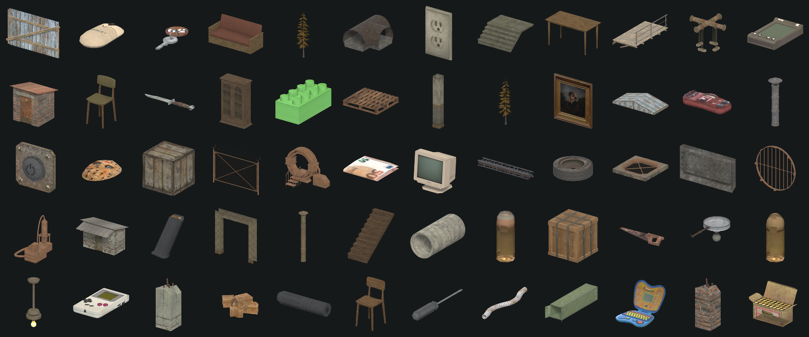

# PSX Asset Browser

Turn a folder of PSX-style asset packs into one searchable, self-contained HTML
catalogue — every model rendered, counted and cross-referenced.

**No assets are included in this repository.** These scripts read a library you
already own and build the browser on your machine. Nothing is uploaded anywhere
and the output never leaves your disk.



*60 of 1,361 models, rendered by the pipeline below.*

## What the browser gives you

* **Every model rendered.** Batch-rendered in Blender at a fixed 3/4 angle, framed
  to each model's own bounding box, on a transparent background.
* **Numbers that matter.** Triangle and vertex counts, real-world size in metres,
  which textures each model uses, and both FBX and GLB paths with copy buttons.
* **A triangle-budget filter.** A log-scale histogram of the visible set that you
  drag to filter by poly count — the constraint that actually bites when you are
  dressing a scene.
* **Relationships.** For each model: its *variants*, what it *goes with* (models
  painted from the same texture sheet, so built for the same scene), and what it
  *looks like* (perceptual-hash neighbours). All navigable.
* **Plain-language descriptions** of what each thing is and where you would put it.
* **Textures and audio** indexed alongside, with resolutions, durations and inline
  playback.

Everything is embedded in a single HTML file. Double-click it — no server, no
build step, no internet.

## Requirements

* **Python 3.9+** with `pillow` and `numpy` — `pip install -r requirements.txt`
* **Blender 3.6+** — only for rendering thumbnails. Everything else runs without it.

## Use it

Point the scripts at your own library. `LIB` is a folder of asset packs, one
folder per pack.

```bash
# 1. See what is in your archives without extracting anything (optional)
python peek_archives.py "path/to/zips" -o index/

# 2. Extract a clean, Unity-ready library from the zips (optional)
python build_unity_library.py "path/to/zips" -o LIB
python dedupe_textures.py LIB --apply

# 3. Render a thumbnail for every .glb  (~5 min for 1,300 models; incremental after that)
blender --background --factory-startup --python render_thumbs.py -- LIB thumbs/ --size 256

# 4. Work out how the models relate to each other
python build_relations.py thumbs/ -o relations.json

# 5. Build the browser
python build_browser.py LIB thumbs/ \
    --relations relations.json \
    --descriptions descriptions.json \
    -o LIB/ASSET_BROWSER.html
```

Steps 1 and 2 are only needed if your packs are still zipped. If you already have
a folder of packs, start at step 3.

### Options

| Flag | Effect |
|---|---|
| `--no-audio` | Omit the audio index. Audio is the one thing that plays from disk rather than being embedded, so a build shared without the packs should use this. |
| `--relations` | Adds the variants / goes-with / looks-like strips. |
| `--descriptions` | Adds the plain-language description on each model. |
| `--size N` (render) | Thumbnail resolution. 256 is a good default. |
| `--force` (render) | Re-render everything instead of only what is missing. |

### Merging a second bundle

`merge_bundle.py` adds another set of zips into an existing library, skipping
anything already there. It compares images by *decoded pixels*, not by hash — a
re-exported PNG has different bytes but identical pixels, so hashing alone misses
real duplicates.

```bash
python merge_bundle.py "path/to/more/zips" LIB --apply
```

## descriptions.json

`descriptions.json` maps a model *family* to what it is and where you would use it.
Families are derived from the naming scheme, so one entry covers every variant:
`metal_barrel_hr_1` through `metal_barrel_hr_4_1` share a description.

It is keyed by family id, so it applies to any library using the same packs. If
you have models it does not cover they simply render without a description — use
`prep_describe.py` to generate shards for the families you are missing.

## A note on the assets

The packs this was built for ship under a licence that allows use in any game,
commercial or not, and free modification — but **prohibits redistributing the
assets, even edited, and prohibits bundling them**. So this repository contains
tooling only. Buy the packs, run the scripts, get your own browser.

If you built something from this, credit for the underlying art belongs to the
pack authors, not to this tool.

## Licence

Tooling is MIT (see `LICENSE`). It says nothing about the assets you point it at —
those keep whatever licence they came with.
